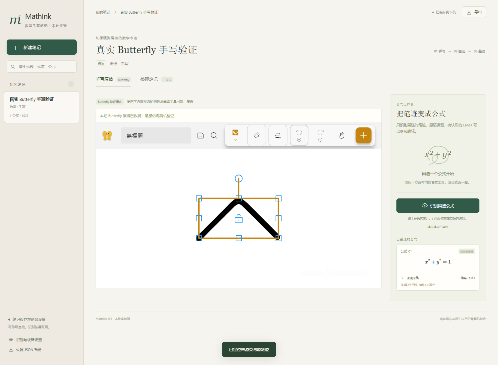

# MathInk · 数学手写笔记

手写 → 圈选公式 → AI 转写 → 对照原稿 → 按需检查公式 → 保存 LaTeX → 整理进知识库 → 返回原稿。

这是可运行的开发预览。发布 ZIP 和插件包含实际构建的 Butterfly 及离线中文字体；首次克隆可先用实验画布。真实云端服务、原生安装包和两端笔感仍需分别验收。预览包不代表已通过应用市场审核。



## 本地运行

需要 Node.js 24 和 pnpm 11.25.0。首次克隆主仓库即可运行实验界面，无需下载整个上游源码。

```powershell
git clone https://github.com/inthispiece/math-ink.git
cd math-ink
pnpm install --frozen-lockfile
pnpm dev:demo
```

打开终端显示的 `http://localhost:5173`。先用笔或鼠标写公式，再套索圈选。当前命令运行演示服务，请点击独立的「查看固定样例演示」体验排版与整理：**演示不读取笔迹、不上传、不限次数**。主按钮「转写为 LaTeX」必须使用已配置的真实服务，不会以固定样例代替识别结果。

若已在 `D:\note`，直接从 `pnpm install` 开始。常用命令：

| 命令 | 用途 |
| --- | --- |
| `pnpm dev:demo` | 本机实验；显式查看固定样例，不识别笔迹 |
| `pnpm dev:ocr` | 使用 `.env` 中配置的真实后端 |
| `pnpm dev:local` | 使用电脑本地 Ollama/Qwen |
| `pnpm local:pull` / `pnpm local:serve` | 下载本地模型 / 启动本地服务 |
| `pnpm dev:lan` | 同一局域网平板实验，终端显示可直接打开的配对链接 |
| `pnpm check` | 类型检查、单元/接口测试、构建 |
| `pnpm test:e2e` | 浏览器完整流程测试，默认使用 Edge |
| `pnpm test:preview` | 已构建 ZIP 的实际解压运行、离线重载和网关验证 |
| `pnpm test:butterfly` | 真实 Butterfly 本地资源、手写、桥接与原稿恢复验证 |
| `pnpm build` | 输出 `dist/web`、思源插件和原生客户端引导资源 |
| `pnpm preview` | 启动已构建的离线资源预览，默认 `http://127.0.0.1:8787` |
| `pnpm package:preview` | 生成可下载预览 ZIP、思源插件 ZIP 和 SHA256 清单 |
| `pnpm doctor` | 查看开发工具是否可用 |

这台电脑已完成构建时，可双击 `Start-MathInk.cmd` 启动本机预览；同一 Wi-Fi 平板实验双击 `Start-MathInk-Lan.cmd`，或在 `D:\note` 运行 `.\Start-MathInk.cmd -Lan`。打开启动窗口显示的地址或配对链接。CMD 入口直接运行 Node，无需调整 PowerShell 执行策略。原 `Start-MathInk.ps1` 仍可使用。GitHub Release 的开发预览 ZIP 只需 Node.js 24，无需安装 npm 依赖。

## AI 转写、公式检查与平板实验

设置可切换 **DeepSeek 云端、本地 Qwen3-VL-2B、Mathpix**。主按钮只负责把圈选图片忠实转为 LaTeX；“检查公式”单独提交编辑框中的公式与手填条件，展示原式、问题和建议。点击“采用建议到编辑框”才修改输入，确认整理才保存。切换后端无需重启网关；修改服务端 .env 后需要重启。

完整配置与操作见 [AI 中文指南](docs/AI-SETUP.md)，应用设置也有离线帮助。

后续开发采用 DeepSeek 云端主线、Qwen 本地可选模式，阶段安排与验收标准见 [AI 开发计划](docs/AI-ROADMAP.md)。

2026-10-24 开发版已接入整页工作台：完整原稿与中英数学结构块对照、行内公式、阅读顺序编辑、本段/本页上下文建议、逐条或批量采用/拒绝/撤销，以及保留原内容的新整理草稿。手写工具栏点击“整页排版草稿”进入；每次云任务单独展示发送范围。全文检索、人工/建议关联、未验证证明提示和独立本地多项式核对也已提供。新增云功能仍是开发实验，真实页面质量及账单尚未验收。

升级前请导出完整备份。新备份采用 schema 2，可导入 schema 1 并保留来源 ID；已有同 ID 笔记只有在导出现有备份并明确确认后才覆盖。旧客户端会拒绝新备份；不同域名/IP 需手动导出再导入，登录不自动同步。

真实评测工具及 40 道待人工核验检查题见 [evaluation](evaluation/README.md)，运行 pnpm eval:ai --help 查看入口；没有真实云端成绩。托管版的账号、成本保护、运维和 HTTPS 配方见 [部署说明](deploy/README.md)，公网服务器与真实质量评测须另行配置。

- **DeepSeek：** 在电脑 .env 填写 DEEPSEEK_API_KEY，模型默认为 deepseek-flash。设置选 DeepSeek，检查连接后再转写。API 按用量计费，密钥不能填在配对令牌栏。没有凭据不会返回模拟样例。
- **本地 Qwen：** 本机已准备便携运行时及 qwen3-vl:2b-instruct；其他电脑先安装 Ollama，再运行 Setup-Qwen.cmd 下载模型。使用时保持 Start-Qwen.cmd 运行，在设置选本地 Qwen。模型运行在电脑，平板通过网关使用，不扣云端次数，不会自动切云端。
- **Mathpix：** 保留原后端，按 [原 Mathpix 配置步骤](docs/MATHPIX-SETUP.md)填写凭据，可作为识别对照；它不支持本应用的 AI 文本公式检查。

电脑和平板连接同一 Wi-Fi 后双击 Start-MathInk-Lan.cmd，平板打开启动窗口的配对链接。本机页面可自动配对；自动生成的令牌保存在 .local/pairing-token，重启复用，明确环境配置优先。电脑与平板的笔记各自保存在浏览器，不自动同步；建议导出备份。局域网 HTTP 用于受信网络开发，公网使用 HTTPS。

云端转写与检查共用本服务预算，当前开发配置为每浏览器实例每天 200 次、服务合计每天 1,000 次及每月 10,000 次；设置显示已用、剩余及重置时间。供应商余额、token 账单和限流另算，本地 Qwen 与固定演示不限这些次数。代码未读取配置文件时仍采用 10 / 200 / 2000 的保守预算。

本轮还增加金额保护：默认每用户每天 5 元、每月 50 元，全服务每天 50 元、每月 500 元。它与次数限制同时生效，可能先达到金额上限。未配置当前模型的价格时，本地实验每次按 0.5 元占用预留，未知费用不自动退回，不能把预留当成实际账单或费用上界；托管版则拒绝未配价格的云生成。运营者可在 `.env` 调整预算并配置核对过的带日期价格，步骤见 [部署说明](deploy/README.md)。

云端按供应商分别同意上传；检查只发送公式文本及手填条件，不发送图片或整页笔记。失败、取消保留原稿；没有后台自动重试，明确点击“重新转写/检查（可能再次计费）”会新建调用。切换笔记、后端或修改待检查文本会使旧建议失效。详见 [隐私说明](docs/PRIVACY.md)。升级后若仍显示旧界面，电脑按 Ctrl+Shift+R 强制刷新，无需清除笔记。

## 思源插件和独立客户端

`pnpm build` 后把 `dist/plugin/math-ink` 复制到思源工作空间 `data/plugins/`，在插件设置启用，再打开 MathInk。插件支持通过公开 API 保存原稿资产、公式块和来源属性。在应用设置填识别服务地址；配置服务端允许的思源页面 Origin，并使用配对令牌。

上游源码与双端构建见 [构建说明](docs/BUILD.md)。独立客户端使用自己的包名、协议及本地端口，并内置数学界面；鸿蒙目标为 5.1+，安卓最低 Android 10。安装与手写性能以真机验收为准。

在包含完整资源的预览中，打开「识别与设备」选择「本地 Butterfly」，使用画布内的钢笔和套索。实际浏览器已验证书写、选区隔离、可编辑公式、原稿回溯与离线重开；[开发预览验收记录](docs/DEVELOPMENT-PREVIEW.md) 列出已验证范围与尚待配置的项目。

## 数据和开源

笔迹、确认后的公式及笔记存放设备本地。导出 `.mathink.json` 可恢复完整实验笔记；Butterfly 模式另保留原 `.bfly` 文档。Markdown 和 LaTeX 导出可用于论文及其他笔记软件。

AGPL-3.0-only。第三方说明见 [THIRD_PARTY_NOTICES.md](THIRD_PARTY_NOTICES.md)，架构见 [ARCHITECTURE.md](docs/ARCHITECTURE.md)，发布条件见 [发布清单](docs/RELEASE.md)。
