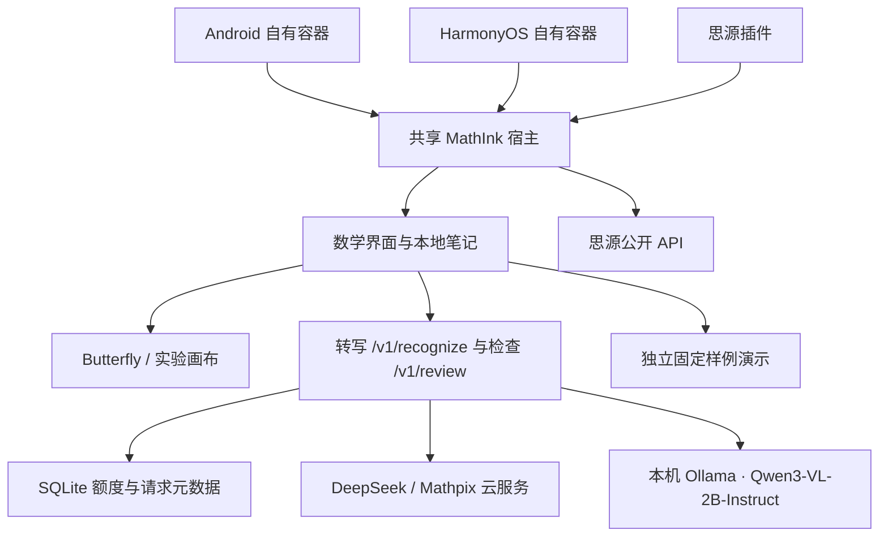

# 架构

`apps/web` 负责笔迹、套索、选区导出、预览纠错和本地 IndexedDB。实验画布单独标注；不冒充 Butterfly。

`apps/gateway` 使用 Node 24 内置 HTTP 与 SQLite。转写接受选区 PNG，检查接受 LaTeX 与用户补充条件，二者独立协议、独立请求命名空间；检查建议必须明确采用。客户端每个请求选择后端，供应商凭据只保存在网关。`GET /v1/status` 提供模型、能力和超时，鉴权后的 `/v1/provider-health` 只探测元数据，不生成内容；配置与试用见 [AI-SETUP.md](AI-SETUP.md)。

DeepSeek/Mathpix 云调用前原子预占共用日/月预算，本地 Qwen 与演示不限云额度。相同安装实例与请求 ID 不重复调用；重启后无法恢复结果正文的旧请求返回明确错误。没有后台自动重试；用户明确重新提交才创建新 ID，云端可能再次计费。本地接口只允许回环地址，每次生成前拒绝远程模型，不会自动转云端。SQLite 仅保存请求元数据与用量，图片、公式和检查条件不入库。

`apps/host` 与 `apps/plugin` 将界面放入同源 iframe，只接受来源窗口和 Origin 均匹配的消息。公式与原稿通过思源 API 保存；源文件先保存成功，再创建公式块。公式块属性记录笔记 ID、笔迹 ID、修订和选区。每次确认公式不会改变原稿修订，修改笔迹则提示旧结果可能过期。

原生宿主的资源由 `dist/web`、`dist/host` 打包到思源资源；容器和 Go 内核使用一致的独立端口。调试包不使用原产品云账户或原发布签名。
