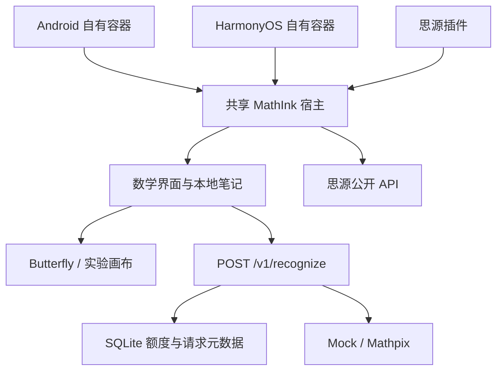

# 架构

`apps/web` 负责笔迹、套索、选区导出、预览纠错和本地 IndexedDB。实验画布单独标注；不冒充 Butterfly。

`apps/gateway` 使用 Node 24 内置 HTTP 与 SQLite。只接受 PNG；返回统一识别协议。调用前原子预占日/月额度，相同安装实例与请求 ID 不重复调用。重启后无法恢复结果正文的旧请求返回明确错误，不自动收费重试。

`apps/host` 与 `apps/plugin` 将界面放入同源 iframe，只接受来源窗口和 Origin 均匹配的消息。公式与原稿通过思源 API 保存；源文件先保存成功，再创建公式块。公式块属性记录笔记 ID、笔迹 ID、修订和选区。每次确认公式不会改变原稿修订，修改笔迹则提示旧结果可能过期。

原生宿主的资源由 `dist/web`、`dist/host` 打包到思源资源；容器和 Go 内核使用一致的独立端口。调试包不使用原产品云账户或原发布签名。
