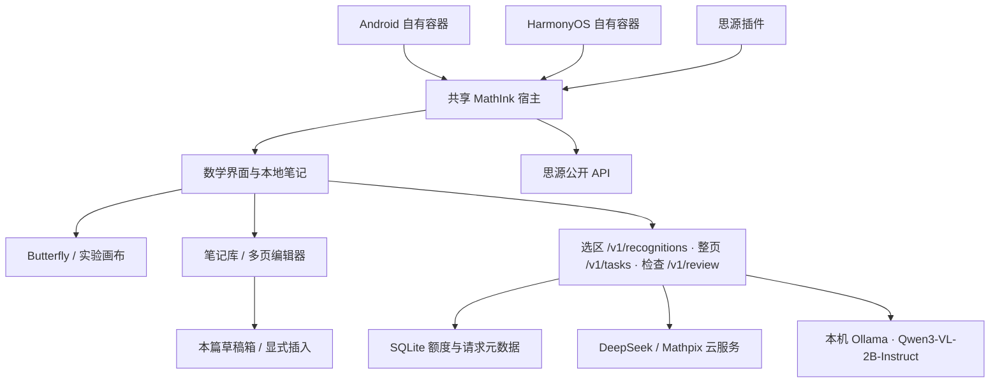

# 架构

`apps/web` 以笔记库为默认入口，`notebook-app.ts` 组织库、独立编辑器、页面导航和按需工具，`notebook-canvas.ts` 管理实验画布。每篇笔记固定自己的 `inkEngine`，设置只决定新笔记默认引擎，未转换原稿时不能隐式切换。Butterfly 原生页目录与宿主页 ID 映射，实验画布按页存笔迹；页顺序独立于块阅读顺序。旧整理正文保为兼容排版页。

`apps/gateway` 使用 Node 24 内置 HTTP 与 SQLite。转写接受选区 PNG，检查接受 LaTeX 与用户补充条件，二者独立协议、独立请求命名空间；检查建议必须明确采用。客户端每个请求选择后端，供应商凭据只保存在网关。`GET /v1/status` 提供模型、能力和超时，鉴权后的 `/v1/provider-health` 只探测元数据，不生成内容；配置与试用见 [AI-SETUP.md](AI-SETUP.md)。

DeepSeek/Mathpix 云调用前原子预占共用日/月预算，本地 Qwen 不扣云额度。相同主体及请求 ID 不重复调用；重启后无法恢复正文的旧请求返回明确错误。重新打开只查询原任务，用户明确重做才创建新 ID，云端可能再次计费。本地模型接口只允许回环地址，每次生成前拒绝远程模型，不自动转云端。SQLite 仅保存请求元数据与用量，图片、公式和检查条件不入库。

`apps/host` 与 `apps/plugin` 将界面放入同源 iframe，只接受来源窗口和 Origin 均匹配的消息。公式与原稿通过思源 API 保存；源文件先保存成功，再创建公式块。公式块属性记录笔记 ID、笔迹 ID、修订和选区。每次确认公式不会改变原稿修订，修改笔迹则提示旧结果可能过期。

原生宿主的资源由 `dist/web`、`dist/host` 打包到思源资源；容器和 Go 内核使用一致的独立端口。调试包不使用原产品云账户或原发布签名。

## 页面、草稿与存储

`notebook-domain.ts` 管理稳定页面 ID、`pageOrder`、`pageStrokes`、每页视图、草稿、去重快照和插入记录。`note.strokes` 仅为当前页兼容投影，不能当作全部页原稿。原稿、正文、块、Butterfly 笔迹及完整页修订分别跟踪。`page-model.ts` 的有序正式块过滤已删除页面与撤销插入；本地搜索和常规导出遵循同一边界。

Draft 独立保存内容、版本、核对状态、来源、任务和使用记录，不进入正式 `blocks/formulas`。整页内容在独立 shadow Note 中复用块编辑器；公式/排版页只有显式插入时才复制为正式实例并分配新 ID。插入实例保持来源和所用版本，草稿后续编辑不联动。原图以内容散列引用去重，资源仅在无引用时清理。

`notebook-repository.ts` 的 `updateNote` 在同一 IndexedDB 事务中读取最新状态并打补丁；草稿结果与任务状态一次提交，原稿编辑不被旧请求快照覆盖。写入有存储修订检查，元数据后台更新保留用户编辑时间。永久删除有 tombstone 防止晚到结果重建；软删除结果只归入回收状态。

完整备份 **schema 3**，IndexedDB **3**，兼容导入版本 1/2；数据库原子升级保留旧格式恢复材料，失败回滚。旧正式内容继续可见可编辑、来源不重写；旧 Butterfly 必须枚举 `.bfly` 全部原生页。常规导出和思源上传均先经过 `formalNoteForExport`，排除未插入草稿、任务、建议及私有快照，完整备份保留它们。跨 Origin 仍靠用户导出/导入。

`native-state.ts` 使用 fflate 只解析有界原生文档元数据与页面 JSON，不展开媒体。原生撤销/重做同步 placement/insertion/usage 状态；保留 canonical 数据供重做，已撤销实例从显示、导出和搜索中过滤。复制原生页校验完整元素内容后重新绑定新元素 ID，不能继续指向原页元素。

## 应用级任务与托管服务

完整页由实验画布全部笔迹或 Butterfly renderPage 导出，带页坐标变换，包含屏幕外内容并排除隐藏层。getDocument 同时返回 ink revision 与完整页 revision。服务器返回阅读顺序中的文字、行内公式、公式行及原图区域；设备保存草稿与任务进度。每个任务当前固定一个有界子调用，失败或重启不自动重新计费。

`draft-tasks.ts` 在发送前持久化所属笔记、来源页、输入版本、原请求 ID、服务地址及主体标识；不在任务内复制凭据。完成仅事务更新原草稿，关闭面板、换页或换笔记不取消任务，也不抢焦点。若等待期间用户先改草稿正文，保留手工版本，模型结果另存。结果保存失败保留内存并提供重试/导出。

`POST /v1/recognitions` 创建可查询选区任务，`GET /v1/recognitions/:id` 或 `/by-request/:clientRequestId` 查询；`POST /v1/tasks` 及对应查询用于整页和其他任务，两者提供明确取消入口。兼容旧同步 `/v1/recognize`；文字公式检查 `/v1/review` 中断后不保证可恢复。恢复过程只 GET 原请求，不能隐式新 POST。切换后端只影响新任务，旧连接或会话不可用时等待原身份恢复。

DeepSeek 的整页、上下文、整理、关联和限定证明任务分别验证结构与证据；Qwen/Mathpix 未评测的新任务禁用。结果正文仅在服务器内存和用户设备，SQLite 只存元数据；重启/过期丢失正文明确返回不可恢复。成功保存自动进入本篇草稿箱，模型输出不会直接改写正式内容。

托管模式用账号和可撤销会话，可信账号决定次数、频率、并发及日月金额；费用原子预留，供应商未返回用量时保留未知，对账有审计。缺少当前模型带日期价格时拒绝托管生成。静态界面与 Node 服务共用 HTTPS Origin。只对明确可信代理读取由其覆盖的客户端 IP。

本地全文检索以当前内容重建，人工链接有反向链接和断链/变化状态。云关联只看勾选的有限候选。证明文本始终标为未验证建议；独立有界多项式工具验证声明范围内的恒等式或原函数求导关系，不执行任意代码，也不代替一般证明。思源导出按页面顺序维护稳定原生块和来源属性；已移除的既有导出内容标记失效保留，避免删除用户在思源中的编辑。

普通书写不依赖网关；已打开笔记可离线保存，生产 Web 完成资源缓存后支持离线重开。云任务仍需联网，本地 Qwen 需电脑模型服务可达。原生客户端、真实平板笔感和真实云端质量/费用分别验收，浏览器隔离响应不构成这些验收证据。
