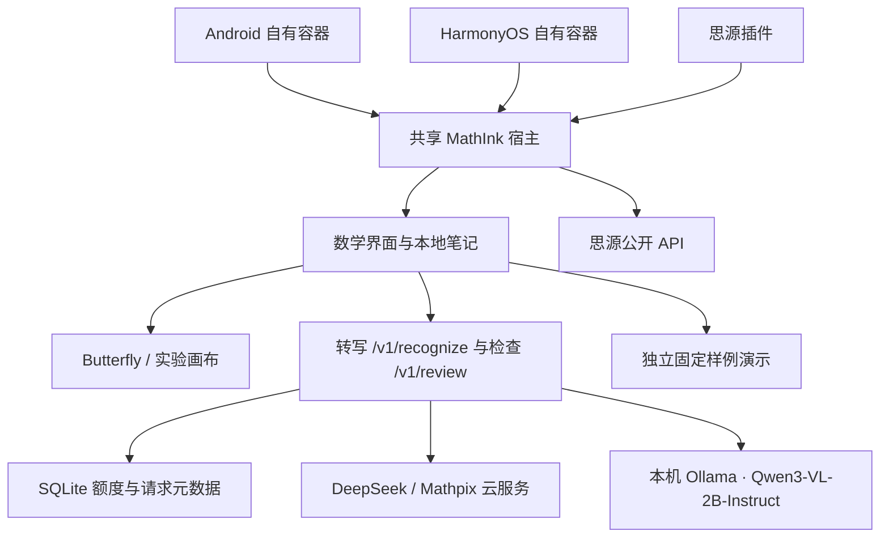

# 架构

`apps/web` 负责笔迹、套索、选区导出、预览纠错和本地 IndexedDB。实验画布单独标注；不冒充 Butterfly。

`apps/gateway` 使用 Node 24 内置 HTTP 与 SQLite。转写接受选区 PNG，检查接受 LaTeX 与用户补充条件，二者独立协议、独立请求命名空间；检查建议必须明确采用。客户端每个请求选择后端，供应商凭据只保存在网关。`GET /v1/status` 提供模型、能力和超时，鉴权后的 `/v1/provider-health` 只探测元数据，不生成内容；配置与试用见 [AI-SETUP.md](AI-SETUP.md)。

DeepSeek/Mathpix 云调用前原子预占共用日/月预算，本地 Qwen 与演示不限云额度。相同安装实例与请求 ID 不重复调用；重启后无法恢复结果正文的旧请求返回明确错误。没有后台自动重试；用户明确重新提交才创建新 ID，云端可能再次计费。本地接口只允许回环地址，每次生成前拒绝远程模型，不会自动转云端。SQLite 仅保存请求元数据与用量，图片、公式和检查条件不入库。

`apps/host` 与 `apps/plugin` 将界面放入同源 iframe，只接受来源窗口和 Origin 均匹配的消息。公式与原稿通过思源 API 保存；源文件先保存成功，再创建公式块。公式块属性记录笔记 ID、笔迹 ID、修订和选区。每次确认公式不会改变原稿修订，修改笔迹则提示旧结果可能过期。

原生宿主的资源由 `dist/web`、`dist/host` 打包到思源资源；容器和 Go 内核使用一致的独立端口。调试包不使用原产品云账户或原发布签名。

## 页面工作台与托管任务

Page/Block/SourceRef/Suggestion/Task 使用稳定 ID；公式数组是唯一 LaTeX 来源，段落和独立块通过 ID 引用。原稿修订、内容修订、块修订及 Butterfly 完整页修订分开。建议绑定目标和上下文快照，采用及撤销都不能覆盖后续编辑。备份 schema 2 导入 schema 1，IndexedDB 升级同事务保留可恢复快照；跨 Origin 数据仍靠用户导出/导入。

完整页由实验画布全部笔迹或 Butterfly renderPage 导出，带页坐标变换，包含屏幕外内容并排除隐藏层。getDocument 同时返回 ink revision 与完整页 revision。服务器返回阅读顺序中的文字、行内公式、公式行及原图区域；设备保存草稿与任务进度。每个任务当前固定一个有界子调用，失败或重启不自动重新计费。

POST /v1/tasks 创建任务，GET /v1/tasks/:id 查询，POST /v1/tasks/:id/cancel 取消。DeepSeek 的整页、上下文、整理、关联和限定证明任务分别验证结构与证据；Qwen/Mathpix 未评测的新任务禁用。结果正文在服务器内存和用户设备，SQLite 只存元数据；重启丢失正文明确返回不可恢复。

托管模式用账号和可撤销会话，可信账号决定次数、频率、并发及日月金额；费用原子预留，供应商未返回用量时保留未知，对账有审计。缺少当前模型带日期价格时拒绝托管生成。静态界面与 Node 服务共用 HTTPS Origin。只对明确可信代理读取由其覆盖的客户端 IP。

本地全文检索以当前内容重建，人工链接有反向链接和断链/变化状态。云关联只看勾选的有限候选。证明文本始终标为未验证建议；独立有界多项式工具验证声明范围内的恒等式或原函数求导关系，不执行任意代码，也不代替一般证明。思源导出按页面顺序维护稳定原生块和来源属性；已移除的既有导出内容标记失效保留，避免删除用户在思源中的编辑。
