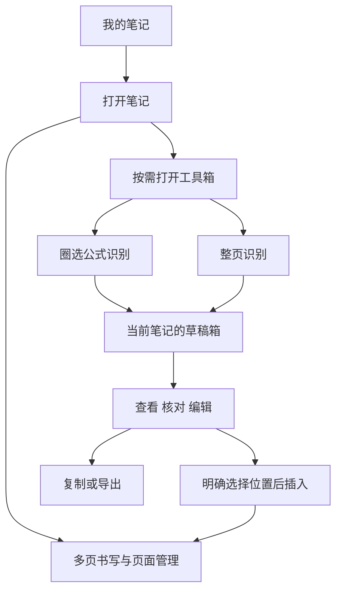

# MathInk 前端交互改造计划

版本：第一版。更新：2026-10-26。

MathInk 首先是一款可独立使用的多页手写笔记软件。用户进入软件先看到全部笔记，打开一篇笔记即可书写；需要时再从工具箱调用公式识别或整页识别。识别产物自动保存在这篇笔记的草稿箱，供以后查看、修改、复制或插入。

近期开发优先级调整为：笔记库 → 多页书写 → 笔记内草稿箱 → 数学工具整合。DeepSeek 主线、Qwen 可选的模型策略继续沿用；已有 AI 能力保留，并迁入新的交互结构。

## 核心交互规则

1. 软件默认首页是“我的笔记”，不自动打开最近笔记。进入已有笔记恢复上次阅读页和位置；新建笔记直接进入第一张空白页。
2. 书写界面以纸面和常用书写工具为主。识别配置、公式编辑、知识关联和证明面板按需打开。
3. 圈选本身不触发识别。用户明确选择识别工具并提交后，才开始模型调用。
4. 识别成功即持久化到所属笔记的草稿箱，不需要先点击“确认并整理”才能保留结果。
5. 保存草稿、核对草稿、插入笔记是三个独立操作。识别完成不自动插入画布、不改写正文、不新建或切换笔记。
6. 草稿可以长期保存和反复使用。使用一次后仍在草稿箱，修改草稿不会联动改写以前插入的内容。

## 信息结构和导航

这里的“一篇笔记”就是一本可包含多张页面的手写文档。首版沿用产品中的“笔记”称呼，不再增加一层含义相近的“笔记本”。

“草稿箱”是每篇笔记自己的长期内容区，不是临时任务日志，也不是首页上一堆新的笔记。应用级设置放在笔记库和编辑器的更多菜单，服务状态只在使用对应工具时展开。

## 笔记库首页

首页显示笔记封面预览、名称、页数和最近编辑时间，支持搜索、按最近编辑排序，以及新建笔记。空库显示“新建第一篇笔记”和“导入备份”；不预先创建数学示例，不要求配置 AI。

笔记操作包括重命名、置顶、复制、导出和移入回收站。删除整篇笔记时，页面和草稿一同进入回收站，恢复时一并恢复。首版先把这些基本操作做可靠，文件夹、多层目录、跨设备同步后续再扩展。

首页和编辑器分成两个明确视图。进入笔记后，原来的全部笔记列表不再长期占据左侧空间；左侧空间用于当前笔记的页面缩略图。需要换笔记时，通过“我的笔记”返回首页。

“最近编辑”按用户对笔迹或正文的修改排序。后台识别结果到达只增加该笔记的草稿提示，不应把正在浏览的笔记库重新排序。

## 多页手写编辑器

默认界面的功能分布如下，具体视觉样式留到下一步原型确认：

| 区域 | 默认内容 | 展开后的内容 |
| --- | --- | --- |
| 顶部 | 返回我的笔记、标题、保存状态、工具箱、草稿箱、更多 | 重命名、导出、设置 |
| 书写工具条 | 笔、橡皮、颜色、粗细、撤销、重做、移动 | 普通选择、笔预设等次级操作 |
| 页面导航 | 当前页码、前后页、新增页、页面概览入口 | 缩略图、拖动排序、页面菜单 |
| 主区域 | 当前页纸面 | 只有用户打开工具或草稿时才显示辅助面板 |

首版采用分页书写：主区域一次编辑一页，通过页码和缩略图切换。纵向连续浏览在分页和笔感稳定后再加入，不把“纸面可无限平移”当作已经有多页笔记。

页面基本操作包括新增、插入、复制、排序、删除与恢复，至少提供空白、横线、方格纸。页 ID 稳定，页码随排序计算；来源引用按页 ID 定位，不能因为第 2 页移动到第 5 页而跳错原稿。

打开笔记默认恢复上次书写页与缩放位置，进入即可落笔。切页先结束当前笔画并确认保存，再切换画布文档；保存失败时保留当前内容，提供重试或导出入口。自动保存必须覆盖笔迹、页面顺序和插入对象，提示“已保存”前应完成实际持久化。

手写笔负责书写，双指负责平移和缩放；无手写笔时提供手指书写开关。翻页有明确按钮和缩略图入口，不把常用书写动作解释为翻页。掌触、笔压、旋转、后台恢复和连续书写须在目标平板验收。

## 数学工具箱

工具箱中的首屏只突出两个主要工具：

| 工具 | 输入 | 默认去向 |
| --- | --- | --- |
| 识别公式 | 用户圈选的笔迹 | 当前笔记的一条公式草稿 |
| 识别整页 | 明确选定的完整页面 | 当前笔记的一条整页草稿 |

公式检查、上下文纠错、笔记整理、知识关联和证明辅助放入次级工具分组。相关操作也可从草稿详情中调用，结果保留为建议或草稿新版本。首版整页识别只提交当前一页，多页批量识别后续加入。

选择“识别公式”后进入一次性的圈选状态，显示简短提示和取消按钮。用户圈定范围后能调整选区，再点击“开始识别”；提交成功后恢复之前的书写工具。已有普通选择也可通过菜单转为识别输入，但不会因选择动作本身触发上传。

选择“识别整页”后展示页码、完整页缩略图和发送范围，再提交任务。整页指画布的完整页面，包含视口外内容；页面快照完成后，后续书写不改变本次输入。

未配置服务时，在这个工具内解释配置要求，并提供设置入口。拒绝上传、服务不可用或额度不足时，用户可以直接返回书写。DeepSeek/Qwen 的能力限制继续生效，本地不支持整页时说明原因，由用户主动决定是否换用云端。

## 每篇笔记的草稿箱

草稿箱入口始终可从笔记顶部打开，收起后只保留数量或未读提示。横屏可作为侧栏，竖屏先展示抽屉列表，详细核对时进入全屏详情；不强行把纸面、列表和详情挤成三栏。

### 草稿列表与内容

每条草稿展示可读标题、类型、来源页、内容预览、生成时间及核对状态。例如“第 3 页 · 不定积分”或“第 5 页 · 整页识别”。首版提供“全部、公式、整页”筛选，按最近产生或修改排序，并可在当前笔记内搜索。

公式详情默认显示排版效果和原始选区。LaTeX 放在“编辑公式”中，需要时再展开。整页详情显示原稿与可编辑的有序段落、公式块，沿用现有分块编辑能力；不把 JSON、模型参数或任务日志作为主要界面。

草稿详情提供：编辑并自动保存、标记已核对、返回原稿、复制、导出、插入笔记、删除。关闭详情不会丢掉已接收结果或已保存修改。“标记已核对”仅表示用户确认内容，不代表数学证明已通过。

删除草稿进入本笔记的草稿回收区，可恢复；已经插入的独立对象继续保留。只有明确永久删除时才清理不再被任何内容引用的快照资源。复制操作以系统剪贴板实际写入成功为准，失败时提供可选择文本，不显示虚假的成功提示。

### 将任务状态与内容状态分开

| 维度 | 状态及行为 |
| --- | --- |
| 处理进度 | 等待、处理中、部分完成、完成、失败、已取消、状态未知；可查询原任务，重做需明确发起 |
| 核对情况 | 待核对、已核对；用户编辑内容后重新标为待核对 |
| 原稿关系 | 原稿未变化、原稿已修改、来源页已删除；变化不删除旧结果 |
| 使用记录 | 记录插入位置与所用版本；已使用草稿仍可继续使用 |

提交识别前就保存一条任务占位记录，结果到达后将任务与内容写入同一所属笔记。只有本地保存成功后才提示“已存入草稿箱”；存储空间不足时保留内存结果，明确提供重试与导出。

切换模型只影响新任务，已有任务继续按原服务和账号查询；退出账号或原连接失效时显示“等待恢复连接”，不暗中换供应商或创建新调用。

部分完成时保留已收到内容并提示范围。切页、切笔记或收起工具面板不会撤销已提交任务。用户关闭应用或系统暂停页面时，不承诺持续后台运行；重新进入后用原任务 ID 查询，状态未知时不自动重新付费生成。

### 草稿如何随时调用

公式草稿选择“插入当前页”后进入放置预览，用户点击位置确认，再成为可移动、可编辑的数学对象。取消放置不影响草稿。复制 LaTeX 和导出图片作为其他使用方式，主要入口保持可编辑公式。

整页草稿可复制部分内容，或点击“作为排版页加入本笔记”，选择插在当前页之后。排版页与手写页在同一个页面列表中，具有明确类型；原手写页继续保留。批量把所有文字和公式压回原手稿位置不作为首版默认操作。

每次插入都生成独立的内容实例，并记录来源草稿及版本。之后编辑草稿不会同步修改先前插入的公式或排版页；撤销某次插入只移除那次插入，草稿仍在。首版默认在当前所属笔记中复用，跨笔记通过明确复制处理。

一次放置操作使用唯一操作标识，双击或重复回调只插入一次；用户再次主动选择插入时才创建新的实例。

原稿修改后，草稿仍可查看和复制，并显示它对应的历史原稿快照。用户核对后可以明确使用历史版本；依赖旧内容的纠错建议仍需重新检查，不能直接覆盖新内容。删除来源页时保留草稿及快照并标记来源缺失，不跳到其他同页码页面。

## 三条关键使用流程

### 只写普通笔记

打开软件 → 我的笔记 → 新建或打开笔记 → 书写 → 新增下一页 → 返回笔记库。

全过程不需要配置模型、不打开识别面板、不产生 AI 请求。下次进入恢复原来的页面、笔迹和视图位置。

### 写到一半识别公式

在第 3 页书写 → 工具箱 → 识别公式 → 圈选并提交 → 继续写字 → 草稿箱出现新结果 → 需要时打开并核对 → 选择位置插入。

识别等待期间可切到第 4 页继续写。完成提示可以显示“第 3 页的公式已存入草稿箱”，但不抢焦点、不翻回第 3 页、不自动弹出详情。

### 整页整理留作以后使用

在第 5 页 → 工具箱 → 识别整页 → 核对页码和范围并提交 → 返回笔记库或继续书写 → 下次打开同一笔记的草稿箱 → 编辑整页草稿 → 作为新排版页加入该笔记。

关闭草稿箱后，草稿继续保存在原笔记下。整页识别完成本身不增加笔记库中的笔记数量，也不改变已有页面数量。

## 当前实现与改造重点

截至 2026-10-26，项目已具备 Page/Block/SourceRef、独立内容修订、整页任务持久化、备份 schema 2、来源回溯和部分草稿编辑能力。这些应继续复用；当前缺口主要在内容归属、手写分页和界面组织。[当前开发记录](DEVELOPMENT-PREVIEW.md)

| 当前行为 | 需要改成的行为 |
| --- | --- |
| 启动自动进入最近笔记，首次自动创建数学笔记 | 先进入全部笔记首页，用户主动打开或新建 |
| 左侧全部笔记列表与右侧公式工作台常驻 | 独立笔记库；编辑器主要显示纸面，工具按需展开 |
| 手写原稿与整理笔记两个主标签 | 一个笔记编辑器，页面导航与本笔记草稿箱各有清晰入口 |
| 实验画布使用整篇 `note.strokes`；结构化页面下拉不直接切换原稿页 | 真正的每页原稿存储、页面顺序和画布页切换 |
| 选区结果停留在临时输入框，确认时保存公式并可能插入 Butterfly | 结果自动存为独立草稿，用户另行决定是否插入 |
| 整页任务接收结果时直接追加到笔记的块与公式 | 内容先归属整页草稿，插入时才进入正式页面 |
| 采用整理建议时复制成一篇新笔记并跳转 | 保存为当前笔记的整理草稿，用户主动导出为新笔记才创建 |
| 页面工作台组件管理轮询，切换笔记会中止本机等待 | 独立任务管理，按原笔记 ID 保存结果，界面只订阅显示 |

旧的“整理笔记”中已经保存的内容继续可见、可编辑。迁移不能把现有正式内容全塞进草稿箱，也不能因隐藏旧标签而让用户找不到它们。

## 数据和组件调整

### 页面和草稿分开归属

继续使用现有 Page 和内容块类型，补齐手写页顺序、纸张设置、原生画布页映射及每页视图状态。现有 `Page.blockOrder` 代表结构化内容的阅读顺序，不能拿它替代手写页面顺序。

每篇笔记的原稿继续由同一个画布文档管理，按稳定原生页 ID 映射；实验画布将笔迹移到按页存储的结构，旧 `note.strokes` 迁入第一页。统一页面目录同时容纳手写页和用户主动插入的排版页。

旧 Butterfly 笔记必须从保存的 `.bfly` 原生文档枚举全部页面，包含从未访问或识别的页面。现有 `note.pages` 主要由当前页和公式来源建立，不能当作原稿的全部页清单。迁移保留原生顺序，并建立原生页与宿主页面的稳定映射。

新增具有独立生命周期的 Draft，至少保存：草稿 ID、所属笔记 ID、类型、来源页及输入版本、原稿快照引用、内容版本、关联任务 ID、核对状态、使用记录和删除状态。

草稿内容可复用现有段落和公式类型，但其可编辑数据应有独立归属。当前自动将 `note.formulas` 归一化为正式内容块的逻辑需要调整，不能因为草稿里有公式就让它自动出现在正文或常规导出里。插入时复制内容并重新分配实例 ID，同时保留来源引用。

### 保存和异步任务

新增草稿仓储与应用级任务管理，任务发起时固定所属笔记、来源页、输入版本和服务配置。完成后按这些标识保存，不能读取“当前打开笔记”作为结果归属。

当前选区公式仍使用同步 `/v1/recognize`，尚不能通过现有任务查询接口恢复。阶段 C 需要为选区识别补齐可查询任务或结果查询协议，复用请求去重、额度及身份隔离，并保持原接口兼容；单纯移动前端轮询代码不能提供这项能力。协议补齐前，中断的选区调用明确标为状态未知。即使补齐，服务端已丢失结果正文时也不能承诺恢复或自动重新调用。

后台保存结果时读取并合并最新笔记状态，通过事务和版本检查只更新所属草稿、任务与资源引用；不能把请求发起时捕获的整篇旧笔记覆盖回数据库。对同一笔记的书写保存、草稿编辑和结果到达统一协调，避免“归属正确但覆盖了新笔迹”。任务仅记录服务和账号标识，凭据沿用现有安全存储，不另存任务内副本。

原稿图片快照按资源引用保存并去重，避免每次编辑都重复存一份大图；草稿元数据、内容、资源引用与任务完成状态按事务提交。关闭面板只改变显示状态，不销毁结果或任务记录。

删除笔记后迟到的结果只允许归入该笔记的回收状态，不能把笔记重新带回首页。永久删除时终止本机收取并清理所属数据，服务端已开始的调用仍可能计费。来源快照的清理按引用处理，避免删除原稿页时把其他草稿需要的图片一起删除。

### 模块拆分与兼容

建议逐步将 `main.ts` 和 `page-workbench.ts` 中的职责拆为：笔记库视图、笔记编辑器、页面导航、数学工具箱、草稿列表与详情、任务管理、存储与迁移。延续现有技术栈，不把换框架作为这次改造的前置条件。

复用 `butterfly-session.ts` 的保存与会话边界，补齐页面管理和指定目标位置插入的桥接。确认真实引擎支持后再开放按钮，不能只更新宿主页码却仍写在同一张画布上。

备份扩展为包含页面、草稿、快照和使用记录的新格式，继续导入旧版本并保留迁移前快照。旧整理内容保留为可访问的排版页或兼容内容视图，维护旧块 ID 与来源映射；原来已经写入画布的公式对象按原稿保留。能从历史任务确定归属的识别结果可补建草稿记录，不能再次插入造成重复。历史上已另存成独立笔记的整理稿保持独立，不自动合并。

常规笔记导出只包含正式页面；完整备份包含草稿箱。导出草稿通过草稿详情发起。思源导出保持原有正式内容及稳定来源属性，不能把整个草稿箱混入正文。

## 平板体验与视觉方向

以纸面和内容为视觉重点，减少大标题、流程口号、常驻帮助文字和服务指标。保留清楚的页码、保存状态及必要操作；正常书写时不显示 LaTeX 输入框和识别结果栏。

横屏允许收起页面缩略图，并按需打开右侧工具或草稿。竖屏将页面概览、工具箱和草稿列表改为抽屉或独立详情；任何弹层都可明确关闭。工具和草稿切换应保留内容与编辑位置。

主要触控目标按约 44 像素设计并真机检查；按钮同时具有图标和可理解的名称，关键功能不依赖悬停。桌面支持常规快捷键，文本输入时不误触书写快捷键。缩略图按需生成，切换侧栏不重新挂载整个画布。

## 分阶段实施

| 阶段 | 交付内容 | 完成条件 |
| --- | --- | --- |
| A 笔记优先的界面结构 | 笔记库、独立编辑器、默认纸面、收起原数学工作台、工具与草稿入口原型 | 无 AI 配置也能完成建笔记、书写、返回和重开；旧内容仍可找到 |
| B 可靠的多页书写 | 页面存储与迁移、真实引擎切页、新增/复制/排序/删除/恢复、缩略图、撤销重做、保存状态 | 同一篇多页笔记连续写入和重开不串页、不丢笔迹；页排序后来源仍正确 |
| C 持久化草稿箱 | 公式与整页草稿、详情编辑、任务管理、选区任务查询协议、快照、备份恢复 | 结果自动归入原笔记；收起面板、切笔记、重开后仍可查看；正式正文无自动变化 |
| D 数学工具与草稿复用 | 圈选识别、整页识别、放置公式、加入排版页、使用记录 | 两种识别都完成工具→草稿→显式插入流程；重复使用、取消与撤销语义一致 |
| E 平板与旧数据验收 | 横竖屏、笔与触摸、性能、服务异常、旧笔记与思源兼容 | 下表核心场景通过，再交付体验版 |

先完成 A 和 B，让普通笔记体验独立成立；C 的数据设计可与 B 并行，D 依赖 C。阶段 A 的入口原型可以使用固定样例说明交互，不能把原型视为草稿箱和后台任务已完成。近期暂停扩大 AI 功能面，集中完成这套交互。

## 验收场景

| 场景 | 必须达到的结果 |
| --- | --- |
| 首次使用且没有密钥 | 进入笔记库，创建笔记后立即可写；不弹出 AI 配置，不产生模型请求 |
| 普通书写 | 打开已有笔记一次进入编辑器；连续多页书写、撤销、重做、重开一致，数学面板默认关闭 |
| 页面管理 | 插入、复制、排序后笔迹与来源仍对应原页；删除可恢复，其他页内容不变 |
| 公式识别后离开 | 无需确认整理，结果已在原笔记草稿箱；原画布没有新公式对象 |
| 整页识别 | 得到一条可编辑的整页草稿；不自动增加正式页、不替换原页、不新增独立笔记 |
| 任务中切页或换笔记 | 结果仍存原笔记和原来源页，当前书写、焦点、页面及笔记库排序不被打断 |
| 重开应用 | 已保存草稿仍在；未完成任务查询原 ID，无法恢复时说明状态，不静默新建调用 |
| 反复使用草稿 | 同一稿可插入多次；各实例独立，编辑草稿不联动，撤销插入不删草稿 |
| 来源变化或删除 | 旧草稿与快照仍可查看，提示来源状态；不会误定位到其他页面 |
| 笔记删除与迟到结果 | 删除后不被任务结果重新创建；从回收站恢复时页面和草稿共同恢复 |
| 存储满、断网或识别失败 | 保留笔迹和已收到草稿，说明失败位置并可重试/导出；书写不依赖服务在线 |
| 备份和导出 | 完整备份往返恢复草稿及来源；正常笔记导出不混入未插入草稿 |
| 旧多页原稿升级 | 从原生文档读取全部页面，未访问或未识别的页面也完整保留；已有画布公式与整理内容不重复生成 |
| 平板使用 | 真机检查横竖屏、笔压、掌触、缩放、切页和后台恢复，工具面板关闭后回到原书写位置 |

另以固定目标平板测试 100 篇笔记、单篇 30 页的首页和翻页体验，记录启动、切页、保存、内存及书写延迟。首轮建立基线，再确定性能预算；用延迟生成缩略图和只加载当前页等措施控制规模影响。

实现时按模块运行现有类型、数据、浏览器和 Butterfly 验证，并新增上述用户流程覆盖。交互验收与模型准确率评测分开：使用隔离响应可以证明结果归属和不打断书写，不能证明识别效果。

## 与 AI 开发计划的关系

本计划决定首页、编辑器、工具和草稿的交互归属，优先于 [AI 开发计划](AI-ROADMAP.md) 中旧的界面组织假设。识别、上下文纠错、知识关联和证明辅助继续沿用已有服务能力及验收限制，并统一成为笔记内可调用的工具。

下一轮先制作“笔记库、正常多页编辑器、工具箱、草稿列表、草稿详情、插入预览”六个关键状态的原型，再按 A–E 实施。本次交付是改造计划，当前前端行为仍以 [开发预览记录](DEVELOPMENT-PREVIEW.md) 和实际代码为准。
